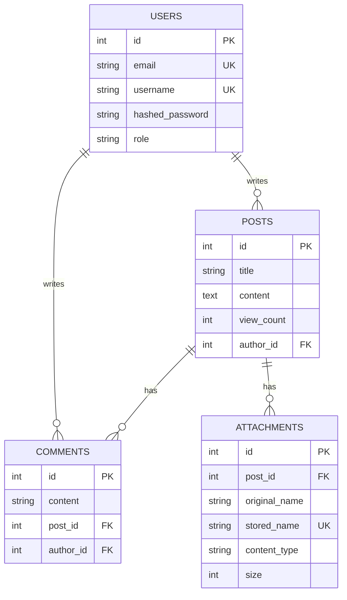

# 게시판 REST API — FastAPI + PostgreSQL + JWT

회원가입·로그인(JWT), 게시글·댓글 CRUD, 작성자 권한 검사, 첨부파일 업로드를 제공하는 RESTful 게시판 API입니다.

- 배포 주소: http://EC2-PUBLIC-IP
- Swagger UI: http://EC2-PUBLIC-IP/docs
- 기술: FastAPI, SQLAlchemy 2.0 (async) + asyncpg, PostgreSQL 16, Pydantic v2, PyJWT, bcrypt, Docker Compose, AWS EC2

## API 목록

| 메서드 | 경로 | 인증 | 설명 | 성공 |
|---|---|---|---|---|
| POST | `/api/v1/auth/signup` | | 회원가입 | 201 |
| POST | `/api/v1/auth/login` | | 로그인, JWT 발급 (form: username=이메일, password) | 200 |
| GET | `/api/v1/users/me` | ✔ | 내 정보 | 200 |
| GET | `/api/v1/posts?page=&size=&q=&author_id=` | | 게시글 목록 (페이지, 검색, 작성자 필터) | 200 |
| POST | `/api/v1/posts` | ✔ | 게시글 작성 | 201 |
| GET | `/api/v1/posts/{post_id}` | | 게시글 상세 (댓글·첨부 포함, 조회수 +1) | 200 |
| PATCH | `/api/v1/posts/{post_id}` | 작성자 | 게시글 일부 수정 | 200 |
| DELETE | `/api/v1/posts/{post_id}` | 작성자 | 게시글 삭제 (댓글·첨부 함께) | 204 |
| GET | `/api/v1/posts/{post_id}/comments` | | 댓글 목록 | 200 |
| POST | `/api/v1/posts/{post_id}/comments` | ✔ | 댓글 작성 | 201 |
| DELETE | `/api/v1/comments/{comment_id}` | 작성자 | 댓글 삭제 | 204 |
| POST | `/api/v1/posts/{post_id}/attachments` | 작성자 | 첨부파일 업로드 (이미지·PDF, 5MB) | 201 |
| GET | `/health` | | 서버·DB 상태 | 200 |

관리자(`role = 'admin'`)는 모든 글과 댓글을 수정·삭제할 수 있습니다.

## 폴더 구조

```
app/
├─ main.py                 앱 생성, 미들웨어·라우터·예외 핸들러 등록
├─ core/
│  ├─ config.py            환경 변수 설정 (pydantic-settings)
│  ├─ security.py          bcrypt 해싱, JWT 발급·검증
│  ├─ exceptions.py        커스텀 예외 + 공통 오류 응답 핸들러
│  ├─ middleware.py        요청 ID, 처리 시간, 접근 로그
│  └─ cache.py             TTL 메모리 캐시
├─ db/
│  ├─ session.py           비동기 엔진, 세션 의존성
│  └─ models.py            User, Post, Comment, Attachment
├─ schemas/                요청·응답 Pydantic 스키마
└─ api/
   ├─ deps.py              현재 사용자, 작성자 확인
   └─ routers/auth.py, posts.py
tests/test_api.py          API 테스트 11개
Dockerfile, docker-compose.yml
```

## REST 설계 원칙
- URL은 자원(명사, 복수형), 동작은 HTTP 메서드로 표현: `GET /posts`, `POST /posts`, `PATCH /posts/{id}`
- 하위 자원은 경로로 표현: `/posts/{id}/comments`, `/posts/{id}/attachments`
- 상태 코드: 생성 201, 삭제 204, 입력 오류 422, 인증 없음 401, 권한 없음 403, 없음 404, 중복 409, 파일 크기 413, 파일 형식 415
- 버전을 경로에 포함(`/api/v1`)해 나중에 바꿔도 기존 클라이언트가 깨지지 않게 함
- `PATCH`는 보낸 필드만 수정

## 오류 응답 형식

모든 오류는 같은 모양입니다. `request_id`는 응답 헤더 `X-Request-ID`와 같아서 서버 로그에서 해당 요청을 찾을 수 있습니다.

```json
{
  "error": {
    "code": "VALIDATION_ERROR",
    "message": "입력값을 확인하세요.",
    "details": [
      { "field": "email", "reason": "value is not a valid email address: ..." },
      { "field": "password", "reason": "비밀번호는 영문과 숫자를 모두 포함해야 합니다." }
    ]
  },
  "request_id": "6f1c2a9b0d3e"
}
```

| code | 상태 | 상황 |
|---|---|---|
| VALIDATION_ERROR | 422 | 형식·길이·공백 등 입력 오류 |
| DUPLICATE_EMAIL / DUPLICATE_USERNAME | 409 | 가입 중복 |
| INVALID_CREDENTIALS | 401 | 로그인 실패 |
| UNAUTHORIZED / INVALID_TOKEN / TOKEN_EXPIRED | 401 | 토큰 없음 / 위조 / 만료 |
| NOT_AUTHOR | 403 | 작성자가 아닌데 수정·삭제 |
| POST_NOT_FOUND / COMMENT_NOT_FOUND | 404 | 대상 없음 |
| FILE_TOO_LARGE / UNSUPPORTED_FILE_TYPE | 413 / 415 | 업로드 제한 |
| INTERNAL_SERVER_ERROR | 500 | 예상하지 못한 오류 (내부 정보는 숨기고 로그에만 기록) |

### Pydantic 검증
- 가입: 이메일 형식(`EmailStr`), 이름 2~30자 한글·영문·숫자·_, 비밀번호 8~64자 영문+숫자
- 게시글: 제목 1~200자, 본문 1~20000자, 공백만 입력 불가, `PATCH`는 최소 한 필드 필요
- 쿼리: `page ≥ 1`, `1 ≤ size ≤ 50`, 검색어 50자 이하
- 응답은 `response_model`로 직렬화해 정의한 필드만 나갑니다 (비밀번호 해시 노출 차단)

## 데이터 모델



- FK는 모두 `ON DELETE CASCADE`이고 ORM 관계에도 `cascade="all, delete-orphan"`을 걸어, 글을 지우면 댓글·첨부가 함께 지워집니다.
- FK 컬럼과 정렬에 쓰는 `posts.created_at`에 인덱스를 두었습니다.

### 쿼리 효율
- **N+1 방지**: 상세 조회에서 작성자·댓글(과 댓글 작성자)·첨부를 `selectinload`로 한 번에 불러옵니다. 댓글이 100개여도 쿼리 수는 고정입니다.
- **목록의 댓글 수**: 글마다 따로 세지 않고 상관 서브쿼리 하나로 함께 조회합니다.
- **조회수**: `UPDATE posts SET view_count = view_count + 1`로 DB에서 직접 더해, 동시에 여러 명이 봐도 숫자가 빠지지 않습니다.
- **페이지네이션**: `offset/limit`과 `size` 최대 50 제한.

## 인증 · 인가 · 보안
- 비밀번호는 **bcrypt**로 해싱해 저장합니다. 응답 스키마(`UserRead`)에는 비밀번호 필드가 없습니다.
- JWT에는 `sub`(사용자 id), `iat`, `exp`(30분 뒤 만료)를 넣습니다. 검증할 때 알고리즘을 고정하고 `exp`를 필수로 요구합니다. 만료된 토큰은 `TOKEN_EXPIRED`로 구분해 알려줍니다.
- 로그인 실패 시 "이메일 없음"과 "비밀번호 틀림"을 같은 메시지로 응답해 가입 여부가 드러나지 않게 합니다.
- 수정·삭제·업로드 전에 `ensure_owner`로 작성자 본인 또는 관리자인지 확인합니다.
- 업로드 파일은 형식(MIME)·크기를 검사하고, 저장 이름은 무작위 UUID로 바꿔 경로 조작과 덮어쓰기를 막습니다. 1MB씩 나눠 읽어 큰 파일이 메모리를 차지하지 않습니다.
- 비밀값(JWT 키, DB 비밀번호)은 `.env`로만 넣고 저장소에는 올리지 않습니다. Docker 컨테이너는 root가 아닌 사용자로 실행하고, DB 포트는 외부에 열지 않습니다.

## 운영 관점
| 항목 | 구현 |
|---|---|
| 비동기 | 모든 엔드포인트가 `async`, DB는 SQLAlchemy `AsyncSession` + asyncpg, 업로드도 `await file.read()` |
| 미들웨어 | 요청마다 `X-Request-ID` 부여, 처리 시간 `X-Process-Time-Ms` 헤더와 접근 로그 기록, CORS |
| 캐싱 | 게시글 목록을 30초 TTL 메모리 캐시에 저장 (`X-Cache: HIT/MISS`), 글·댓글·첨부가 바뀌면 즉시 무효화 |
| 예외 처리 | 커스텀 예외 클래스 → 전역 핸들러에서 공통 형식으로 변환, 예상 못한 오류는 500 + 로그 |
| 상태 확인 | `/health`에서 DB 연결까지 확인 |
| 테스트 | `tests/test_api.py` 11개 (인증, 토큰 만료, 권한, CRUD, 검증, 캐시, 댓글, 업로드) |

## 로컬 실행

```bash
cp .env.example .env              # 값 수정
docker compose up -d --build      # PostgreSQL + API
# http://localhost/docs
```

코드를 직접 실행하려면 (PostgreSQL이 따로 떠 있어야 함):
```bash
uv sync
uv run fastapi dev app/main.py    # http://localhost:8000/docs
uv run pytest                     # 테스트 (DATABASE_URL에 테스트용 DB 지정)
```

## AWS EC2 배포

1. **인스턴스 생성**: Ubuntu 24.04, t2.micro(또는 t3.micro), 키 페어 생성. 보안 그룹 인바운드에 **SSH 22(내 IP)**, **HTTP 80(0.0.0.0/0)** 추가
2. **접속**
   ```bash
   chmod 400 my-key.pem
   ssh -i my-key.pem ubuntu@EC2-PUBLIC-IP
   ```
3. **Docker 설치**
   ```bash
   sudo apt-get update && sudo apt-get install -y docker.io docker-compose-v2 git
   sudo usermod -aG docker ubuntu && exit   # 다시 접속하면 sudo 없이 docker 사용
   ```
4. **코드 받기와 설정**
   ```bash
   git clone https://github.com/YOUR-ID/YOUR-REPO.git board-api && cd board-api
   cp .env.example .env
   sed -i "s/^JWT_SECRET_KEY=.*/JWT_SECRET_KEY=$(openssl rand -hex 32)/" .env
   nano .env    # POSTGRES_PASSWORD 변경
   ```
5. **실행**
   ```bash
   docker compose up -d --build
   docker compose ps
   curl http://localhost/health
   ```
6. 브라우저에서 `http://EC2-PUBLIC-IP/docs` 접속
7. 코드 수정 후 재배포: `git pull && docker compose up -d --build`

t2.micro는 메모리가 1GB라 빌드가 느리면 스왑을 추가합니다.
```bash
sudo fallocate -l 2G /swapfile && sudo chmod 600 /swapfile && sudo mkswap /swapfile && sudo swapon /swapfile
```

## 캡처


